# Venta Online: Comentarios sobre productos y Valoración de Vendedores

**Marcos de Desarrollo – Curso 2026/2027 – Grupo mad08 (Trustify)**

| Miembro | Login UDC | Parte |
|---|---|---|
| Martín Hernández González | m.hernadezg@udc.es | Usuarios (registro, autenticación, perfil) + OAuth |
| Nicolás Figueroa Lago | n.flago@udc.es | Productos, categorías y valoraciones + caché de búsquedas |
| Maicol Lois Lugo | m.lois.lugo@udc.es | Comentarios y denuncias + etiquetado |

<!--
NOTAS PARA NOSOTROS (borrar antes de imprimir)
- Enunciado §6.3: documento BREVE pero CLARO. Diagramas en UML, de calidad,
  explicados, y NO hechos por ingeniería inversa.
- Se entrega IMPRESA en la defensa de la iteración 2 (si no, -0,5 puntos).
- Iteración 1: solo hay que enseñar los diagramas del apartado 2 en una herramienta UML.
- Leyenda: [ ] pendiente · [~] en curso · [x] hecho
-->

---

## 1. Arquitectura global

<!-- [ ] Responsable: A
Qué pide: estructura global de paquetes (no hace falta UML). Solo los paquetes de
más alto nivel y sus subpaquetes principales, y qué contiene cada uno. -->

Arquitectura en capas: la web solo usa las interfaces de los servicios y los servicios solo acceden a la BD a través de los DAOs.

```
MAD-Template.sln
├── Lib                    ModelUtil.dll: DAO genérico, excepciones, [Transactional]
├── Model                  capa modelo
│   ├── (raíz)             entidades y DbContext generados desde Trustify.Model.edmx (T4)
│   ├── XxxDao             un paquete por entidad (UserProfileDao, ProductDao, CommentDao...):
│   │                      interfaz IXxxDao + implementación con Entity Framework
│   ├── XxxService         un paquete por servicio (UserService, ProductService...):
│   │   │                  interfaz, implementación y DTOs
│   │   ├── Exceptions     excepciones propias del servicio
│   │   └── Util           utilidades (PasswordEncrypter, TagNames)
│   └── SQL                scripts de creación de la BD
├── Test                   pruebas de integración de DAOs y servicios (MSTest)
│   └── Scripts            script de la BD de pruebas
└── Web                    capa web (ASP.NET WebForms)
    └── HTTP
        ├── Session        gestión de la sesión del usuario (SessionManager)
        ├── Util/IoC       configuración de Ninject (IoCManagerNinject)
        └── View           objetos auxiliares de la vista (idiomas, países)
```

---

## 2. Modelo

### 2.1 Clases persistentes

<!-- [ ] Responsable: A
Qué pide: TODAS las clases persistentes en uno o varios diagramas de clases, con
sus relaciones relevantes.
Clases: UserProfile, Category, Product, Comment, CommentReport, Rating, Tag
(+ la relación N:M CommentTag). -->

`[Diagrama 2.1 – Clases persistentes]`

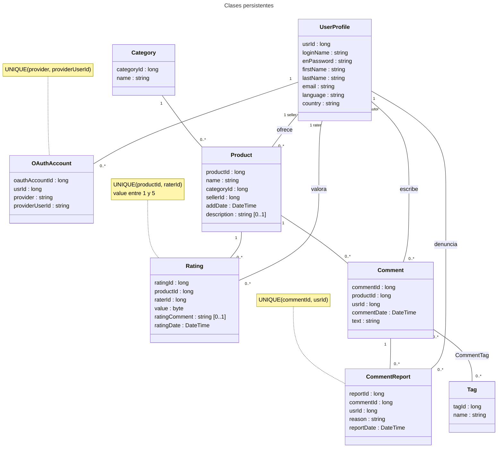

- **UserProfile** es a la vez comprador y vendedor; el vendedor de un producto es `Product.sellerId`.
- **Rating** se asocia al producto, y el vendedor se obtiene de él, sin datos redundantes.
- **CommentReport**: una denuncia por usuario y comentario. "En revisión" no se guarda, se calcula (ver 2.5).
- **Tag** y **CommentTag** (etiquetado) y **OAuthAccount** (OAuth) pertenecen a las partes opcionales.

### 2.2 Interfaces de los servicios ofrecidos por el modelo

<!-- [ ] Responsable: cada uno el suyo
Qué pide: (1) el criterio para agrupar los casos de uso en servicios;
(2) un diagrama de clases POR SERVICIO con la interfaz (declaración completa de
las operaciones) y los tipos de datos que usan (DTOs, excepciones). -->

**Criterio de agrupación**

Un servicio por entidad principal: usuarios, categorías, productos, valoraciones, comentarios (con sus denuncias y la asignación de etiquetas, porque afectan al propio comentario) y etiquetas. Las listas se paginan con `startIndex` y `pageSize`, cada una con su `CountXxx`. Usamos DTOs solo cuando hay que combinar datos de varias entidades.

#### IUserService (A)

`[Diagrama – IUserService + UserProfileDetails, LoginResult, IncorrectPasswordException]`

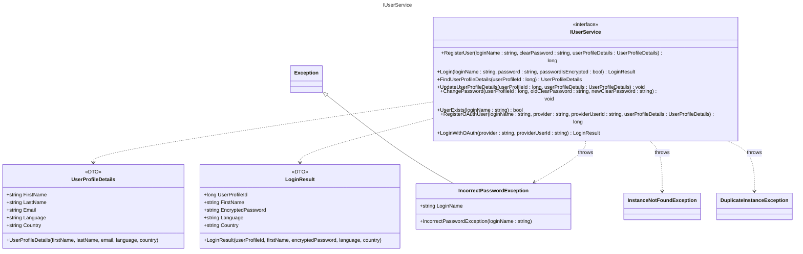

`LoginResult` incluye la contraseña cifrada para "recordar contraseña" (cookie + `Login` con `passwordIsEncrypted = true`).

#### ICategoryService (B)

`[Diagrama – ICategoryService]`

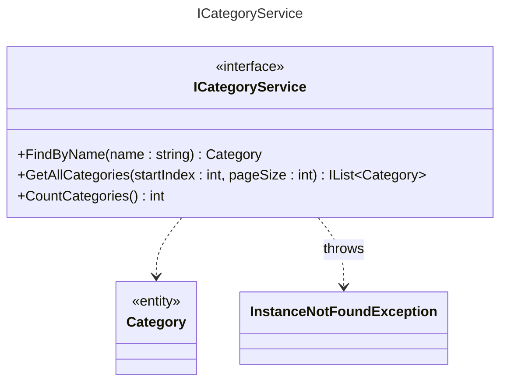

Solo consulta, porque las categorías se insertan por script. Sirve para el desplegable de búsqueda por categoría.

#### IProductService (B)

`[Diagrama – IProductService]`

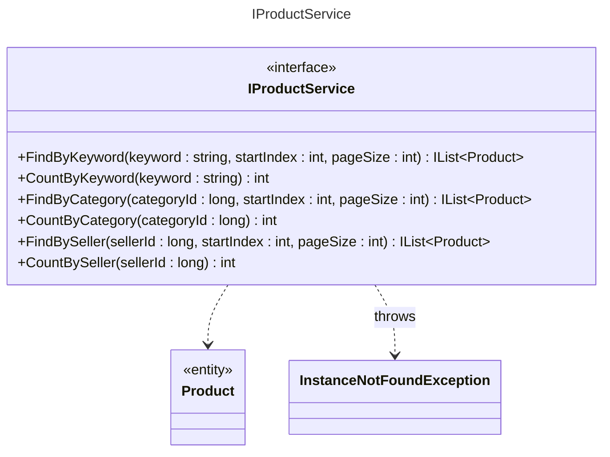

Se devuelve la entidad `Product`, porque desde ella la web llega a la categoría y al vendedor.

#### IRatingService (B)

`[Diagrama – IRatingService + SelfRatingException]`

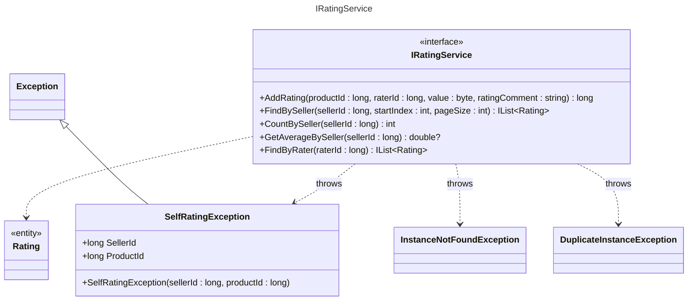

`SelfRatingException` impide que un vendedor se valore a sí mismo y `DuplicateInstanceException`, que valore dos veces el mismo producto.

#### ICommentService (C)

`[Diagrama – ICommentService + CommentDetails, CommentPermissionException, CommentUnderReviewException]`

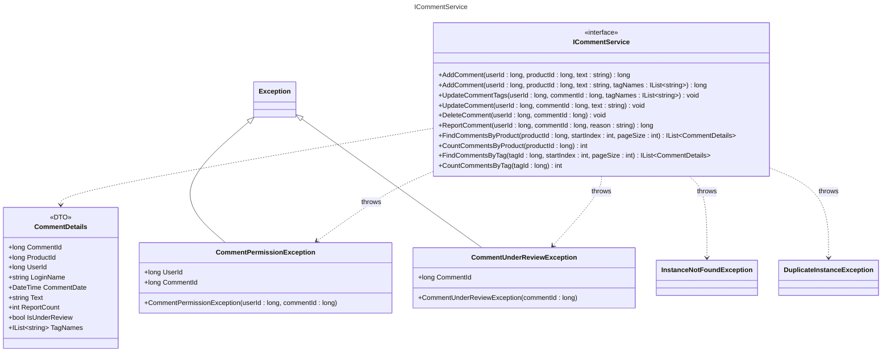

`CommentPermissionException` se lanza si quien edita o borra no es el autor, y `CommentUnderReviewException` si el comentario está "En revisión". `CommentDetails` reúne todo lo que muestra la página de comentarios.

#### ITagService (C, parte opcional)

`[Diagrama – ITagService + TagDetails]`

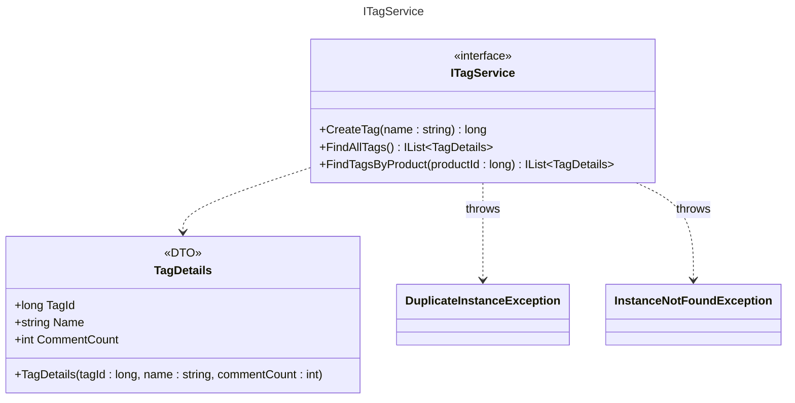

`CommentCount` sirve para el tamaño de cada etiqueta en la nube.

### 2.3 Diseño de un DAO

<!-- [ ] Responsable: A
Qué pide: diagrama(s) de clases con la implementación de UN DAO (el resto es igual).
Propuesta: IUserProfileDao / UserProfileDaoEntityFramework, que heredan de
IGenericDao<E, PK> / GenericDaoEntityFramework<E, PK> (ModelUtil). -->

`[Diagrama 2.3 – UserProfileDao]`

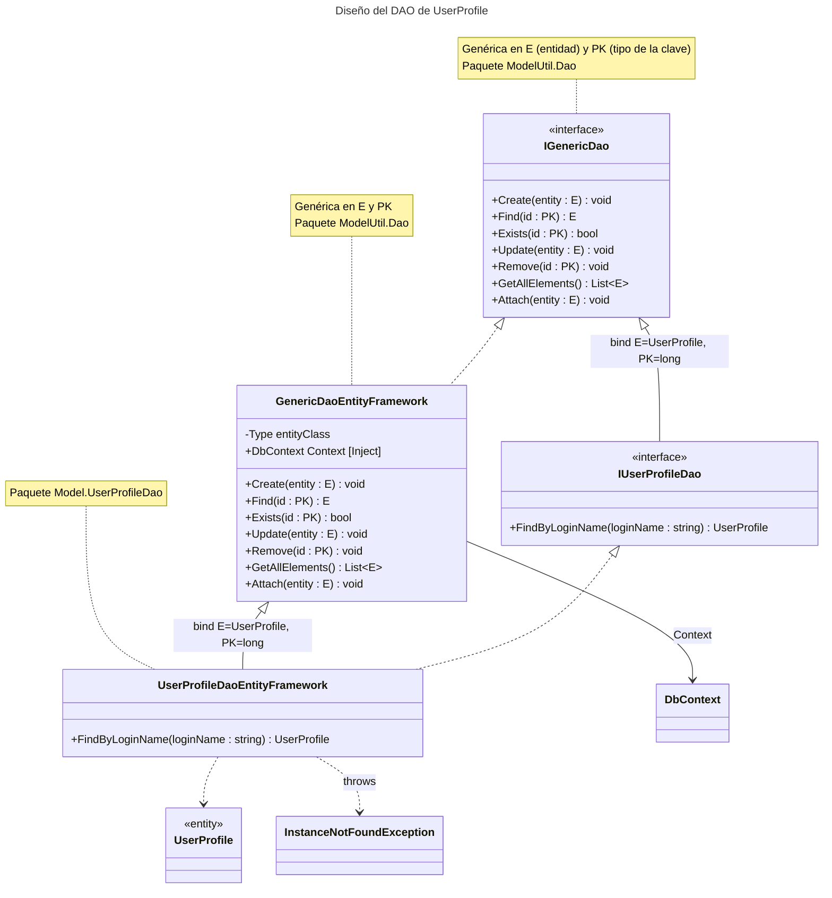

El DAO genérico de ModelUtil implementa una sola vez el CRUD con Entity Framework. Cada DAO concreto lo hereda y solo añade sus consultas; en este caso, `FindByLoginName` con LINQ, que lanza `InstanceNotFoundException` si no encuentra el login. Los servicios dependen solo de la interfaz.

### 2.4 Diseño de un servicio del modelo

<!-- [ ] Responsable: A
Qué pide: (1) diagrama(s) de clases con la implementación de UN servicio;
(2) un diagrama de SECUENCIA de un caso de uso en la capa modelo.
Propuesta: UserService (+ IUserProfileDao, PasswordEncrypter, DTOs) y la secuencia de Login. -->

`[Diagrama 2.4a – Clases de UserService]`

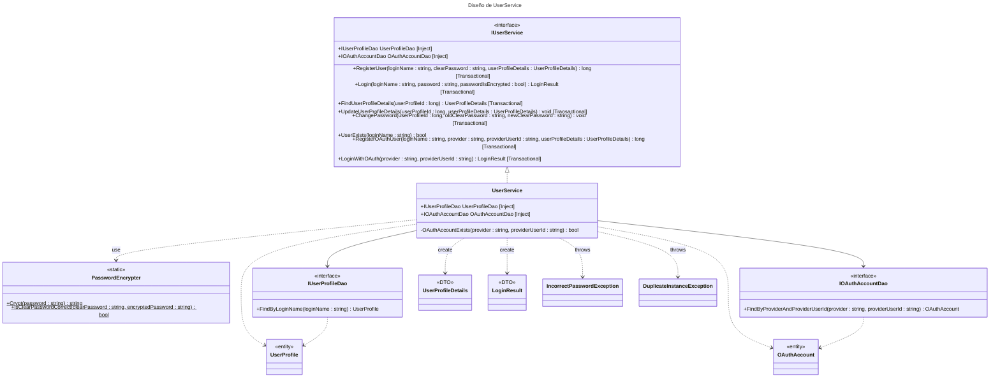

Ninject inyecta los DAOs en `UserService` (`[Inject]`) y cada operación `[Transactional]` se ejecuta en una transacción. El cifrado se delega en `PasswordEncrypter`, y a la web solo salen DTOs, nunca la entidad.

`[Diagrama 2.4b – Secuencia de Login]`

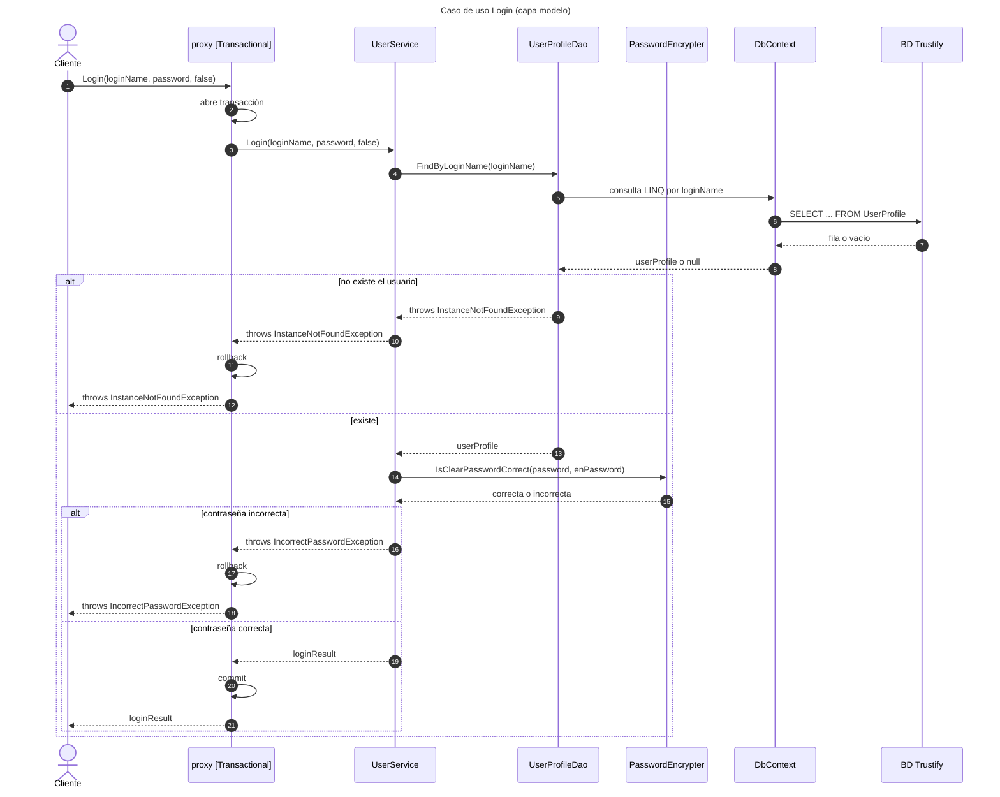

El proxy de Ninject envuelve la llamada en una transacción y el servicio busca el usuario a través del DAO. Si no existe, salta `InstanceNotFoundException`; si la contraseña no coincide, `IncorrectPasswordException`. En los dos casos se hace rollback; si todo va bien, commit y se devuelve el `LoginResult`.

### 2.5 Otros aspectos

<!-- [ ] Opcional: aspectos relevantes de la capa modelo.
Ideas: [Transactional] e inyección con Ninject, plantilla .tt del profesor
(Equals/GetHashCode), cálculo de "En revisión" (3 denuncias), cifrado de
contraseñas (SHA-256), estrategia de los tests (TransactionScope + rollback). -->

- **Ninject:** inyección por propiedad (`[Inject]`) y un único `DbContext` (singleton) compartido por todos los DAOs.
- **`[Transactional]`:** Ninject crea un proxy que envuelve cada método en un `TransactionScope`; hace commit si el método termina bien y rollback si lanza una excepción.
- **Plantilla T4:** genera `Equals`, `GetHashCode` y `ToString` en las entidades, lo que permite compararlas directamente en los tests.
- **"En revisión":** se calcula con 3 o más denuncias; no se guarda, así que siempre es coherente.
- **Contraseñas:** se guarda solo su resumen SHA-256 en Base64.
- **Tests:** cada test se ejecuta en un `TransactionScope` sin `Complete()`, así que todo se deshace al acabar y los tests son independientes.

---

## 3. Interfaz gráfica

<!-- [ ] Iteración 2
Qué pide: diagrama de secuencia de un caso de uso representativo con las clases o
artefactos principales (página .aspx, code-behind, SessionManager, servicio...).
No hace falta detallar el interior del servicio (ya está en 2.4).
Si hace falta, otros aspectos de la interfaz gráfica. -->

`[Diagrama 3 – Secuencia de un caso de uso en la capa web]`

_Pendiente (iteración 2)._

---

## 4. Partes opcionales

<!-- Qué pide: un apartado por cada parte opcional, explicando cómo se ha diseñado
y lo necesario para ejecutarla. -->

### 4.1 Etiquetado de comentarios (C)

- **Modelo:** `Tag` con nombre único y relación N:M con `Comment`. Las etiquetas de un producto son las de sus comentarios.
- **Asignación** (en `ICommentService`): `AddComment` y `UpdateCommentTags` reciben los nombres de las etiquetas y crean las que no existen.
- **Nube y consulta** (`ITagService`): `FindAllTags` y `FindTagsByProduct` devuelven el número de comentarios de cada etiqueta, y `FindCommentsByTag` sirve para el enlace de cada etiqueta.
- **Duplicados:** los nombres se normalizan (sin espacios y en minúsculas), así "Ganga" y "ganga" son la misma etiqueta.

No requiere configuración extra: las tablas se crean con el script general.

### 4.2 Cacheado de búsquedas (B)

`ProductService` guarda en un `MemoryCache` las **5 últimas búsquedas**:

- **Clave:** tipo de búsqueda + valor + página, por ejemplo `FindByKeyword_portátil_0_10`.
- **Orden:** una `LinkedList` lleva el orden de uso; al pasar de 5 entradas se descarta la más antigua.
- **Acierto:** si la búsqueda está en caché, se devuelve sin consultar la BD.
- **Concurrencia:** la caché es `static` y se protege con `lock`.

Como permite el enunciado, la caché no se invalida si cambian los productos. No requiere configuración extra, porque `System.Runtime.Caching` viene con .NET Framework.

### 4.3 OAuth 2.0 (A)

<!-- El enunciado pide además detallar el FLUJO de intercambio de información
(tokens) que permite la autenticación. -->

Proveedor: **Google**. En la iteración 1 está hecho el modelo y en la 2 se hará la web.

**Modelo.** `OAuthAccount` vincula un usuario con su identificador en Google (`provider = "google"`, `providerUserId`). Usamos una tabla aparte para no tocar `UserProfile` y poder añadir otros proveedores.

- `RegisterOAuthUser` crea el usuario y su cuenta OAuth en una transacción. Como contraseña se guarda una aleatoria que nadie conoce.
- `LoginWithOAuth` devuelve el mismo `LoginResult` que el login normal. Si no hay cuenta vinculada lanza `InstanceNotFoundException`, y eso significa que el usuario es nuevo.

**Flujo *authorization code*:**

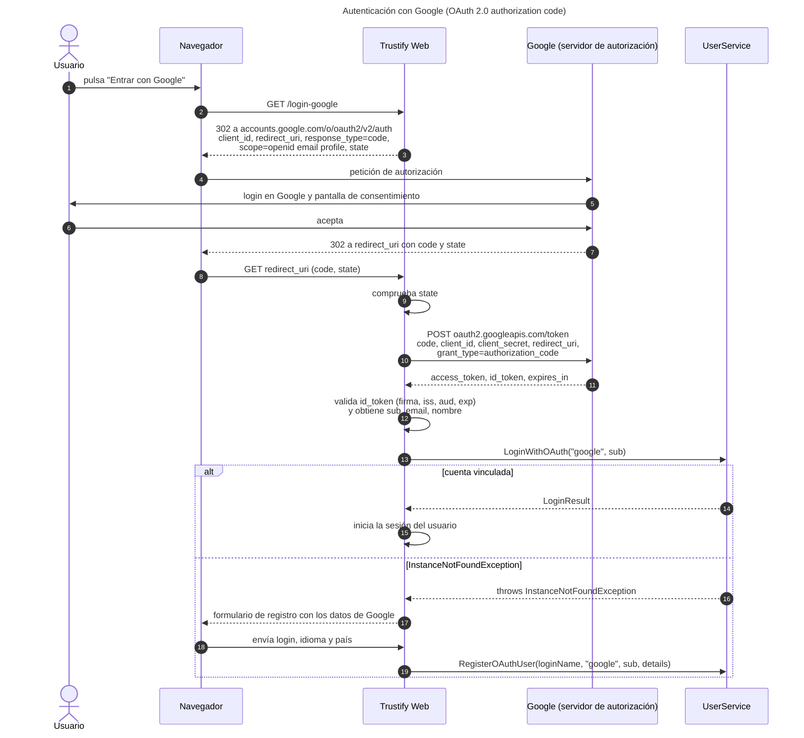

1. **Redirección:** la web envía al usuario a Google con el `client_id`, la `redirect_uri`, los permisos y un `state` contra CSRF.
2. **Consentimiento:** el usuario se identifica en Google, nunca en nuestra web, y acepta.
3. **Código:** Google vuelve a la `redirect_uri` con un `code` de un solo uso.
4. **Tokens:** el servidor cambia el `code` por un `access_token` y un `id_token`, usando el `client_secret`, que nunca pasa por el navegador.
5. **Validación:** se comprueban la firma, el emisor, el destinatario y la caducidad del `id_token`.
6. **Login:** el campo `sub` del `id_token` es el `providerUserId`. Si no hay cuenta vinculada, se registra al usuario con `RegisterOAuthUser`.

Para ejecutarlo hay que registrar la aplicación en Google Cloud Console y poner el `client_id` y el `client_secret` en `Web.config`.

---

## 5. Compilación e instalación de la aplicación

<!-- [ ] Qué pide: cómo compilar e instalar, lo más sencillo posible, suponiendo un
entorno ya configurado (BD y servidor instalados).
Ideas: scripts SqlServerCreateDatabase.sql y SqlServerCreateTables.sql, compilar
MAD-Template.sln, cadena de conexión en Web.config, ejecutar los tests en x64. -->

1. **BD:** ejecutar `Model\SQL\SqlServerCreateDatabase.sql` y `Model\SQL\SqlServerCreateTables.sql`, que crean la BD `Trustify` con datos de ejemplo. Antes hay que ajustar `@Default_DB_Path`.
2. **BD de pruebas:** ejecutar `Test\Scripts\SqlServerCreateTables.Test.sql`, que crea `Trustify_test`.
3. **Conexión:** la cadena `TrustifyEntities` de `Web.config` y `Test\App.config` apunta a `localhost\sqlexpress`.
4. **Compilar** `MAD-Template.sln`.
5. **Tests:** ejecutarlos desde el Explorador de pruebas.
6. **Web** (iteración 2): ejecutar el proyecto `Web` con IIS Express.

---

## 6. Problemas conocidos

<!-- [ ] Lista de errores conocidos del código. -->

- `IoCManagerNinject` (web) solo registra lo de usuarios; falta registrar el resto para la iteración 2.
- `AddRating` no comprueba que exista el usuario que valora. En la web no ocurre, porque siempre es el usuario autenticado.
- El `==` de la plantilla T4 falla si el primer operando es `null`; no lo usamos así.
